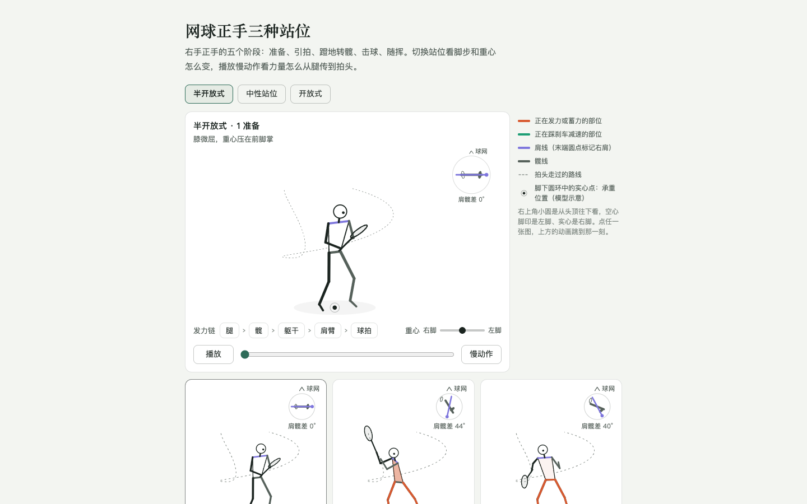
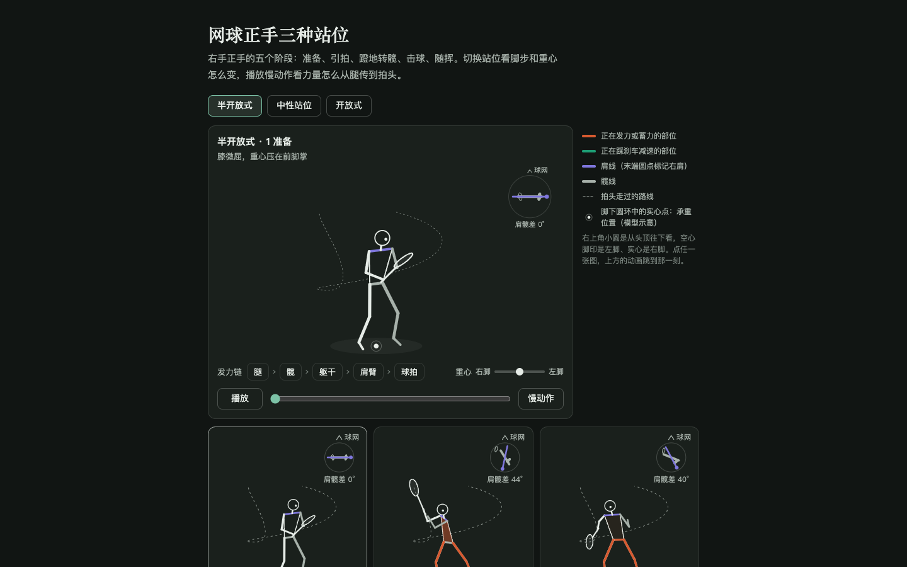
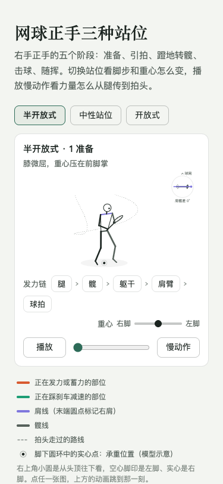
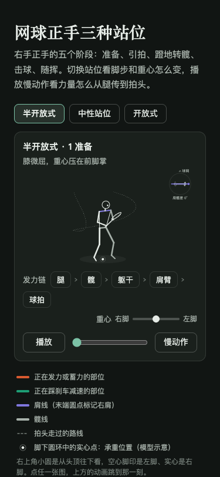

# 网球动作示意网站 · outsider-01

通过连续动画、五阶段图片和肩髋俯视图，帮助网球初学者理解挥拍、站位与承重变化。项目暂无正式站名。

**接手开发请从 [PROMPT.md](PROMPT.md) 开始，当前开发分支是 `m5-quality`。** `main` 保留里程碑 4 完成时的版本，最新二维上线与后续调整位于 `m5-quality`，两者尚未合并。

## 当前两套版本

| 版本 | 源码入口 | 构建 | 状态 |
|---|---|---|---|
| 中文二维正手原型 | `reference/prototype-forehand.html` | `npm run build:prototype` | 已部署到阿里云 |
| 中英双语三维实验室及报告 | `src/`、对应 HTML 入口 | `npm run build` | 本地完整项目，里程碑 5 尚有待办 |

[打开当前二维网站](https://8.209.239.47/outsider-01/)。最后记载的部署为 2026-10-04，发布编号 `20261004T070841Z-3a082a0`。

二维原型自带动作数据和绘制脚本；修改 `src/` 不会自动修改线上二维原型。生产构建会去除原型中的 Google 字体外链，输出同源样式与脚本。

## 已确认的展示方式

- 三个站位：半开放式、中性站位、开放式。
- 动画在上，五张阶段图片在下；桌面图例在动画右侧、顶部对齐。
- 700px 及以下按动画、图例、阶段图片排列。
- 点击阶段图片，上方动画跳到对应时刻；播放、速度和时间轴同步控制人体、肩髋小图及承重指示。
- 肩髋小图保留左右脚、肩线、髋线、右肩末端标记和球网方向。脚下实心点表示模型承重位置。

下面是 2026-10-04 最后一次线上验收截图，作为交接时的视觉基准：

| 桌面浅色 | 桌面深色 |
|---|---|
|  |  |

| 手机视口浅色 | 手机视口深色 |
|---|---|
|  |  |

手机图为桌面 Chrome 的 375×812 视口模拟。

## 获取源码与验证

本机交接验证环境为 Node.js `v25.8.1`；二维构建脚本使用 Node 原生 TypeScript 支持。依赖以锁文件为准。

```bash
git clone --branch m5-quality https://github.com/outsiderrr/outsider-01.git
cd outsider-01
npm ci
npx tsc --noEmit
npx vitest run
```

2026-10-13 交接检查：类型检查通过，22 个测试文件、191 项测试通过，其中包含原六条动作模型约束。

二维原型构建与本地预览：

```bash
npm run build:prototype
python3 -m http.server 4176 --bind 127.0.0.1 --directory artifacts/releases/prototype
```

访问 `http://127.0.0.1:4176/`。构建产物包含 HTML、哈希命名 CSS/JS 和文件校验清单。

完整三维项目开发：`npm run dev`。生产构建与预览：

```bash
npm run build
npm run preview -- --host 127.0.0.1 --port 4173
```

访问 `http://127.0.0.1:4173/outsider-01/`，产物为 `dist/`。

## 接手资料与验证

- [交接提示词](PROMPT.md)：接手步骤、最新范围与协作规则。
- [项目简报](CONTEXT.md)：代码地图、动作模型约定、进度与待办。
- [批准的设计方案](docs/superpowers/specs/2026-10-02-outsider-01-design.md)。
- [品质记录](docs/quality-log.md)：历史检查、发现与修复、性能验证边界。
- [部署说明](docs/DEPLOY.md)：现有阿里云发布与回退方式。

二维浏览器检查使用 `scripts/prototype-release-audit.mjs`，默认访问本机 4176；脚本使用已安装的 Google Chrome。完整三维项目的浏览器、预算和性能命令见 `package.json` 与项目简报。

完整历史截图、报告、构建包和 `node_modules/` 不入库，可按脚本重新生成。本仓库附带四张必要视觉基准图、所需字体文件及其许可证。

## 当前待办与发布范围

三维模式的独立俯视小图仍需接回；历史测量的中文深色 LCP 约 2.55 秒，略超 2.5 秒预算。二维原型手机小图偏小。实体 iOS、Safari 和二维原型的 Lighthouse 尚未实测，详见品质记录。

角度、速度和承重属于示意模型，不作为人体实测值或统一动作标准。参考书的出版社、译者、年份仍待版权页核对；保留字体与素材的来源说明。

本次 GitHub 上传用于源码交接；线上网站继续由阿里云托管。完整三维版替换线上、开启 GitHub Pages 或重大产品范围调整，按用户后续决定执行。
